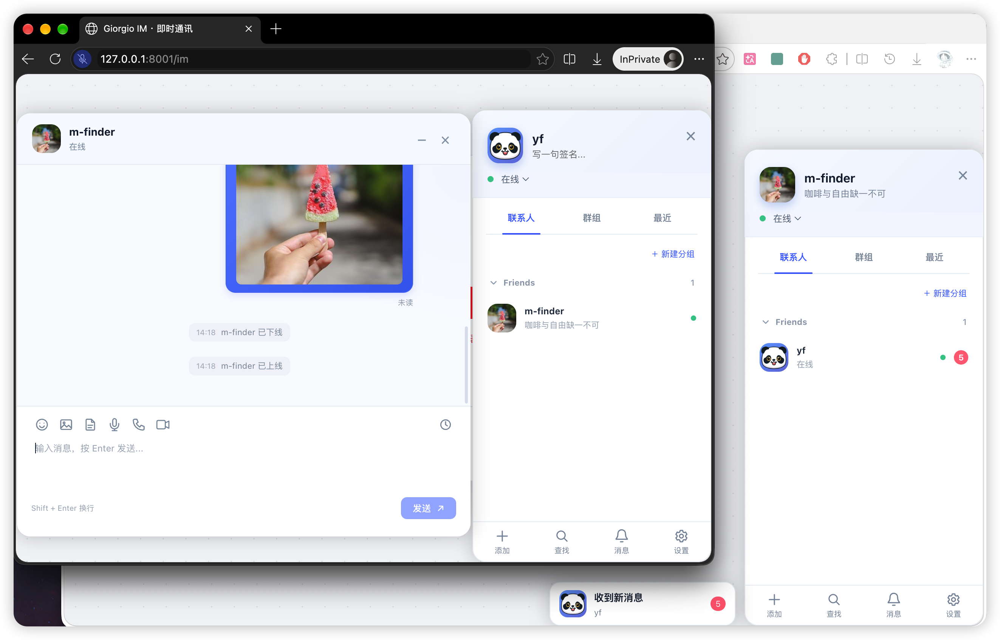

# Giorgio IM

[简体中文](README.md) | [English](README.en.md)

A floating instant messaging component built with Vue 3 and TypeScript, inspired by LayIM's interactions and data structures. Use `createIM()` to mount it, or render it directly in a Vue template.

The component provides contacts, conversations, message rendering and chat controls. Connect your services through callbacks, or use `createConnectedIM()` with the accompanying Laravel + Giorgio Socket backend. AI requests and RTC calls are supplied by your application.

## Preview



## Features

- **Chat interface**: independent, draggable contacts and chat windows, a conversation sidebar, unread indicators, chat history, light and dark themes, and mobile layouts.
- **Contacts**: collapsible categories, drag to move friends, friend requests, category selection, online status and an inbox.
- **Groups**: creation, invitations, leaving, member lists, group profiles, owner and administrator badges, member removal, muting and dismissal.
- **Message tools**: 128 emojis, images, files, voice recording and playback, voice and video call callbacks, and a customisable toolbar.
- **Conversation modes**: standard IM, AI conversations with streaming Markdown, and a single-window customer service mode.
- **Integration**: TypeScript types, Chinese and English, custom language packs, and optional encrypted local backups.

## Contents

- [Quick start](#quick-start)
- [Vue component usage](#vue-component-usage)
- [Laravel and Socket integration](#laravel-and-socket-integration)
- [Messages and data](#messages-and-data)
- [AI and customer service modes](#ai-and-customer-service-modes)
- [Contacts and group management](#contacts-and-group-management)
- [Profiles and attachments](#profiles-and-attachments)
- [Languages](#languages)
- [Local backups](#local-backups)
- [Toolbar extensions](#toolbar-extensions)
- [API reference](#api-reference)
- [Development and verification](#development-and-verification)
- [License](#license)

## Quick start

### Run the demo

From this repository:

```bash
npm install
npm run dev
```

Open the local address printed in your terminal. The demo offers standard chat, AI conversations and customer service mode. Chinese is the default; select English in the top right or use `?lang=en`.

The Chinese and English demos keep separate profiles, friends, categories and chat backups. Switching modes resets window positions, maximised state, open conversations and the draft while retaining contacts and messages. A normal refresh restores the backup. Demo replies and call prompts are local simulations.

### Install in your project

Requires Vue **3.3 or later**. Build and pack this repository, then install the generated package in your application:

```bash
# In the Giorgio IM repository
npm run build
npm pack

# In your Vue project; replace with the actual package path
npm install /path/to/giorgio-im/giorgio-im-0.1.0.tgz
```

The examples below import from `giorgio-im`. Source projects that support Vue SFCs and Vite's inline CSS imports can also import this repository's `src/index.ts` directly.

### Create an instance

```ts
import { createIM, type ImInit } from 'giorgio-im'

const init: ImInit = {
  user: { id: 'me', username: 'Me', sign: 'Stay in touch', status: 'online' },
  friend: [{
    id: 'team', groupname: 'Colleagues',
    list: [{ id: 'alice', username: 'Alice', status: 'online' }],
  }],
  group: [{ id: 'room', groupname: 'Project chat', ownerId: 'me', members: 3 }],
}

const im = createIM({
  init,
  locale: 'en',
  onSendMessage(payload) {
    console.log('Connect your messaging service here', payload)
  },
})

im.chat({ id: 'alice', type: 'friend', username: 'Alice' })
im.getMessage({ id: 'alice', type: 'friend', content: 'Hello!' })
```

`createIM()` mounts into `document.body` and injects its styles. No separate CSS import or Tailwind installation is required. Pass `target: HTMLElement` to choose a mount container; windows still use a floating layout.

Create instances in the browser. In Vue, you can create one in `onMounted` and call `im.destroy()` in `onBeforeUnmount`. `destroy()` unmounts the component; your application cleans up its WebSocket, AI requests and RTC connections.

## Laravel and Socket integration

`createConnectedIM()` connects the widget to the accompanying Laravel API, including authentication, contacts, group management, profiles, attachments, voice messages, history and real time updates.

```ts
import { createConnectedIM } from 'giorgio-im'

// Obtain a token from POST /api/im/login or /api/im/register.
const im = await createConnectedIM({
  apiUrl: '/api/im',
  token: () => currentToken,
  widget: { locale: 'en' },
  onConnectionChange(state) { console.log(state) },
  onError(error, operation, payload) {
    console.error(operation, error)
    // Keep failed payloads and retry with await im.sendMessage(payload).
  },
})
im.open()
// On unmount: im.destroy() clears the widget, requests, socket and timers.
```

| Option | Default / purpose |
| --- | --- |
| `token` | Required Sanctum token or a sync/async function returning the current token |
| `apiUrl` | `/api/im` |
| `socketUrl` | Overrides the URL returned by `/init` |
| `pollInterval` | `5000` milliseconds, minimum `1000`; fetches durable events by cursor |
| `requestTimeout` | `15000` milliseconds |
| `transport.requireTLS` | `true`; remote APIs require HTTPS and sockets require WSS |
| `transport.allowInsecureLocalhost` | `true`; HTTP pages may use HTTP/WS for loopback endpoints; set `false` to require TLS locally too |
| `widget` | Widget options excluding `init`; initial data comes from the server |
| `onConnectionChange` | `connecting`, `online`, `reconnecting`, `offline`, `closed` |
| `onError` | Error, operation name and optional failed send payload |

The connected instance includes the widget API plus `sync()`, `reconnect()`, `sendMessage(payload)`, `deleteFriend(id)` and a read-only `connectionState`. `deleteFriend()` deletes the server relationship. Base methods `removeFriend()` and `removeGroup()` apply results already received from your server.

Use trusted certificates and HTTPS/WSS for the page, APIs, attachments and sockets in production. The adapter validates endpoints before sending tokens and rejects API redirects. HTTPS pages always reject HTTP/WS downgrades. `requireTLS: false` is for explicitly permitted plaintext development only; it does not disable browser certificate verification.

```ts
const im = await createConnectedIM({
  token: accessToken,
  apiUrl: 'https://chat.example.com/api/im',
  socketUrl: 'wss://chat.example.com/socket',
  transport: { requireTLS: true, allowInsecureLocalhost: false },
})
```

For custom registration or login requests, call the exported `assertImTransport(url, 'http', transport)` before sending. The browser and server provide TLS encryption without a shared frontend secret. The local backup `encryptionKey` is unrelated to transport. Enable server policy too; options are listed in the accompanying project's `.env.example`. TLS protects transmission; the server can still read messages.

WebSocket authentication uses short-lived tickets outside the URL. Pushes trigger ordered HTTP event retrieval; polling continues during disconnection, with automatic socket reconnection. Messages are deduplicated using `mid`; preserve the same `mid` when retrying. In this adapter, `widget.onSendMessage` is notified after normal messages are saved by the server. AI requests are delegated directly to that callback.

The adapter supplies management, upload and history callbacks. AI and `onCall` require your own services. Server contacts and the current profile override optional local backups. After a new login, opening a conversation loads the latest 50 messages; there is currently no server unread cursor across logins.

### Local Laravel project

The adjacent `../packages` project uses `"giorgio-im": "link:../giorgio-im"` and imports the component by package name. Rebuild after editing this package:

```bash
cd ../packages
composer install
pnpm install
pnpm run build:im
pnpm run im:demo
```

Open `http://127.0.0.1:8001/im` to register or log in. Registration joins the GIORGIO-IM group and sends friend requests to existing users. Recipients choose a category and accept in their inbox before a mutual friendship is created. Preset accounts and the dual-user test page have been removed.

The startup script uses a separate SQLite database and Redis instance. See the [Laravel integration guide](../packages/docs/im.md) for configuration and endpoints.

## Vue component usage

```vue
<script setup lang="ts">
import { ref } from 'vue'
import { ImWidget, type ImInit, type ImSendPayload, type ImWidgetApi } from 'giorgio-im'

const widget = ref<ImWidgetApi | null>(null)
const init: ImInit = { user: { id: 'me', username: 'Me' }, friend: [], group: [] }

function handleSend(payload: ImSendPayload) {
  console.log('Connect your messaging service', payload)
}
</script>

<template>
  <button @click="widget?.chat({ id: 'alice', type: 'friend', username: 'Alice' })">Contact Alice</button>
  <ImWidget ref="widget" :init="init" locale="en" @send-message="handleSend" />
</template>
```

The component ref exposes the same `ImWidgetApi`; only `createIM()` adds `destroy()`. Pass operation callbacks as props, such as `:load-history="loadHistory"` and `:upload-avatar="uploadAvatar"`. Use events for notifications, such as `@username="saveUsername"` and `@group-renamed="onGroupRenamed"`. Calls use `:on-call="onCall"`.

## Messages and data

### Initial data

| Field | Type and purpose |
| --- | --- |
| `init.user` | Required `ImUser`: `id` and `username`; optional `avatar`, `sign` and `status: 'online' \| 'hide'` |
| `init.friend` | `ImFriendGroup[]`: each category contains `id`, `groupname` and `list: ImContact[]` |
| `init.group` | `ImContact[]`: groups use `groupname` and may include `members`, `ownerId`, `adminIds` and `muteAll` |
| `ImContact` | Requires `id`; friends use `username`, with optional avatar, signature and `status: 'online' \| 'offline'`; set `type: 'ai'` for AI contacts |

IDs can be strings or numbers, including `0`. IDs are compared as strings internally, so `1` and `'1'` identify the same object of a given kind. See [src/types.ts](src/types.ts) for full definitions.

### Sending and receiving

After sending text or an attachment, the component displays the outgoing message, then calls `onSendMessage(payload)`. `ImSendPayload` contains `user`, `receiver`, `content`, `timestamp` and an optional `attachment`. Your application handles delivery acknowledgements, retries and its messaging protocol.

This WebSocket example requires your own endpoint, authentication and server message format. Ensure the connection is ready before sending, and validate incoming data in your application:

```ts
import { createIM, type ImMessage } from 'giorgio-im'

const socket = new WebSocket('wss://your-server.example/im')
const im = createIM({
  init, // Use the initial data from the quick start
  onSendMessage(payload) {
    socket.send(JSON.stringify(payload))
  },
})

socket.addEventListener('message', event => {
  const message: ImMessage = JSON.parse(event.data)
  im.getMessage(message)
})
```

| `ImMessage` field | Description |
| --- | --- |
| `id` / `type` | Required conversation target ID and `'friend' \| 'group' \| 'ai'`; for a group message, `id` is the group ID |
| `content` | Required message text; standard chats render plain text, AI replies support Markdown |
| `mid` | Optional message ID; deduplicates standard messages and associates streaming updates with one AI reply |
| `fromid` / `mine` | Sender ID / whether the message is yours; a `fromid` matching the current user's ID renders as an outgoing message |
| `username` / `avatar` | Sender name and avatar; provide `fromid` on group messages to display role badges |
| `timestamp` | Optional Unix timestamp in milliseconds; defaults to the current time |
| `attachment` | Optional `{ kind: 'image' \| 'file' \| 'audio', url, name, duration? }`; duration is in seconds |
| `finished` / `error` | AI reply completion and error fields; see below |

### History and notifications

`loadHistory(receiver)` returns `ImMessage[]` or a Promise and runs when a conversation first opens. Failed requests can be retried in the interface. Conversations with restored local history do not automatically load it again. The history button is on the right of the chat toolbar.

Use `notices: ImNotice[]` to initialise the inbox, then `im.getNotice()` to add notifications. `ImNotice` contains `id`, `type: 'system' | 'friend-request'`, `title` and `content`, with optional `timestamp`, `contact`, `read` and `resolved`. Include `contact` for friend requests.

### Incoming message alerts

Unread messages from unopened conversations are grouped in a floating New messages prompt with an avatar, conversation names and an unread count. Clicking it adds pending conversations to the chat sidebar and opens the most recently updated one. Other conversations retain unread dots; conversations already in the open chat sidebar no longer appear in the prompt. In customer service mode, it opens the sole support conversation.

Each new unread message briefly shakes the prompt from side to side. Animations respect the system's reduced motion preference, and restoring a backup does not replay the shake.

```ts
import { createIM } from 'giorgio-im'

const im = createIM({
  init,
  messageNotification: true, // Default true; false hides the prompt but keeps unread counts
  messageSound: true,        // Default true; false mutes, or use '/sounds/message.mp3'
})
```

While the chat window is open and the page is visible, all conversations in its open list suppress prompts, vibration and sounds. Inactive conversations still accumulate unread counts and display dots. Alerts resume when the window is minimised or closed, or the page is hidden; returning clears only the active conversation's unread count. Other incoming friend and group messages play a short tone, with bursts throttled. AI replies count towards alerts only on completion and stay silent. Outgoing messages, duplicates, loaded history and restored backups do not play sounds.

Browsers may block audio until the user interacts with the page; receiving messages and visual alerts still work. Vue components accept `:message-notification` and `:message-sound`. Alert text supports built-in and custom language packs.

### Conversation state, read receipts and typing

`createConnectedIM()` connects presence, signature changes, read receipts and typing to the companion API. Open friend conversations show presence and signature changes as centred grey notices. Closed/minimised windows do not accumulate them. These notices never increment unread counts, vibrate or play sounds.

```ts
const im = createIM({
  init,
  chatNotices: { presence: true, signature: true }, // Both enabled by default.
  onRead(payload) { /* Send type, id and mids to your server. */ },
  onTyping(payload) { /* Send type, id and typing; no draft text is included. */ },
})

// Apply server state. Use getMessage for regular messages.
im.setFriendStatus('alice', 'online')
im.getChatNotice({ id: 'alice', event: 'online', mid: 'event-1' })
im.getChatNotice({ id: 'alice', event: 'signature', sign: 'New signature', mid: 'event-2' })
im.setMessageRead({ id: 'alice', type: 'friend', mids: ['message-id'], readerId: 'alice' })
im.setTyping({ id: 'alice', type: 'friend', fromid: 'alice', typing: true, expiresAt: Date.now() + 6000 })
```

`onRead` reports received messages only in the active conversation with the window open and the page visible. Background conversations are not automatically read, even when incoming alerts are suppressed. History may include `readBy: user ID[]`. Private messages show read/unread; groups show unique reader counts, excluding the sender.

Outgoing typing is throttled to once every two seconds and stops after three seconds idle, blur, switching or closing. Incoming state expires within six seconds and stale events are ignored. AI and system entries do not emit read/typing callbacks. Vue components expose `@read` and `@typing`.

`chatNotices.signature=false` hides signature notices for one instance. The companion backend's `IM_SIGNATURE_NOTICES_ENABLED=false` disables sending signature notices while profile updates continue normally.

## AI and customer service modes

### AI conversations

Use `type: 'ai'` with the same `onSendMessage` and `getMessage()` APIs. Your application manages model requests and conversation context by conversation ID; the browser should call your backend.

```ts
im.chat({ id: 'assistant', type: 'ai', username: 'AI assistant', maximized: true })

// After parsing SSE or WebSocket events, pass cumulative content, not just the new chunk.
im.getMessage({ id: 'assistant', type: 'ai', mid: 'reply-1', content: 'Hello', finished: false })
im.getMessage({ id: 'assistant', type: 'ai', mid: 'reply-1', content: 'Hello, **world**!', finished: true })

// End the waiting state on failure while retaining any partial content.
// im.getMessage({ id: 'assistant', type: 'ai', mid: 'reply-1', content: '', error: 'Request failed' })
```

- `finished` defaults to `true` and can be omitted for a complete reply. Keep the same `mid` throughout a streaming reply and use a new one for the next turn. Without `mid`, updates apply to the conversation's pending reply.
- Generation shows a thinking state and disables further sending in that conversation. `chatTimeout` defaults to `60000` milliseconds between the request and first chunk, or between subsequent chunks. Each update resets it.
- The last update must contain the full final content and `finished: true`. After a timeout, your application should cancel the request and ignore late events to keep them out of the next reply.
- AI replies use `markdown-it` with raw HTML disabled. Outgoing messages remain plain text. Closing a window does not cancel your application's network request.

### Customer service mode

```ts
import { createIM } from 'giorgio-im'

const im = createIM({
  init: { user: { id: 'visitor-1', username: 'Visitor' } },
  locale: 'en',
  customerService: { id: 'support', type: 'friend', username: 'Customer support' },
  onSendMessage(payload) { console.log('Send to support', payload) },
})

im.open()
im.close() // Return to the launcher, retaining the conversation, messages and draft
```

This mode shows one conversation with the configured support contact, hiding the contacts panel and conversation sidebar. Closing or minimising returns to the bottom-right launcher, which shows unread counts. Mobile conversations open full screen. Use `type: 'ai'` for AI support. Only `chat()` and `getMessage()` targeting that contact are accepted. Backups are isolated by user and support contact, separately from standard IM.

## Contacts and group management

### Friends and categories

The bottom Find control filters the current contacts, groups or recent list. Add friend uses `findContacts(query)` to discover users. Accepting a request includes choosing or creating a category. Drag existing friends into empty or collapsed categories to move them. Offline avatars are shown in greyscale.

| Option callback | Successful return value |
| --- | --- |
| `findContacts(query)` | `ImContact[]` |
| `requestFriend(contact)` | No value means the request is pending; `true` adds the friend immediately |
| `acceptFriend(contact, groupId, notice)` | `true` or no value |
| `createFriendGroup(groupname)` | `ImFriendGroup` with a server-generated ID |
| `moveFriend(contact, groupId)` | `true` or no value |

These accept synchronous results or Promises. Operation callbacks return `false` or throw to report failure. Without management callbacks, operations are local and new categories use local UUIDs. Call `im.addContacts(contact, groupId)` when your server confirms a request was accepted.

### Group profiles and permissions

Set `ownerId` and `adminIds` on group data to identify roles. `loadGroupMembers(receiver)` returns `ImGroupMember[]` or a Promise; members may include `muted: true`. The title bar's members button opens the list, where clicking another member opens a private chat.

| Action | Owner | Administrator | Member |
| --- | --- | --- | --- |
| Edit group name and avatar | ✓ | ✓ | — |
| Mute or remove ordinary members | ✓ | ✓ | — |
| Mute or remove administrators | ✓ | — | — |
| Enable or disable group-wide muting | ✓ | ✓ | — |
| Appoint or remove administrators | ✓ | — | — |
| Dismiss the group | ✓ | — | — |
| Invite friends | ✓ | ✓ | ✓ |
| Leave the group | Use dismissal | ✓ | ✓ |

Owners and administrators cannot perform member management actions on themselves. Group-wide muting allows owners and administrators to speak; administrators can still be individually muted by the owner. Management controls are hidden when role data is missing. The server must always enforce permissions.

| Option callback | Successful return value |
| --- | --- |
| `createGroup({ groupname, members })` | `ImContact`; selected `members` exclude the current user, who becomes the owner unless the result supplies `ownerId` |
| `inviteGroupMembers(group, members)` / `leaveGroup(group)` | `true` or no value |
| `renameGroup(group, groupname)` | `true` or no value; names must contain 1–40 characters after trimming |
| `uploadGroupAvatar(file, group)` | Avatar URL; the same rules as personal avatars apply |
| `setGroupAdmin(group, member, admin)` | `true` or no value; `admin` is a boolean |
| `removeGroupMember(group, member)` / `dismissGroup(group)` | `true` or no value |
| `muteGroupMember(group, member, muted)` / `muteGroup(group, muted)` | `true` or no value |

These callbacks support Promises. Boolean operations return `false` or throw to retain the previous state. Upload callbacks must return a valid URL. Successful operations update local state and emit the corresponding notification listed in the [API reference](#api-reference). Without callbacks, management changes are local and group avatars default to Data URLs.

### Deleting and blocking friends

Swipe left on a friend to reveal Delete and Block. Desktop users can also right-click or press Shift+F10. Both actions retain recent conversations and chat history. Blocked senders are greyed out and labelled in private and shared group history. Open Settings → Blocked users to unblock; friendship is not restored automatically.

```ts
const im = createIM({
  init, // Optional blocked: ImContact[] and recent: (ImContact & { type: ImChatType })[]
  deleteFriend: async contact => { await api.deleteFriend(contact.id) },
  blockFriend: async contact => { await api.blockFriend(contact.id) },
  unblockFriend: async contact => { await api.unblockFriend(contact.id) },
  onFriendRemoved: contact => console.log('deleted', contact.id),
  onFriendBlocked: contact => console.log('blocked', contact.id),
  onFriendUnblocked: contact => console.log('unblocked', contact.id),
})
await im.blockFriend('alice')
await im.unblockFriend('alice')
await im.deleteFriend('alice')
```

Returning `false` or throwing from a persistence callback keeps local state unchanged. Instance methods return `false` if no action was completed and propagate exceptions. Vue exposes matching props and `@friend-removed`, `@friend-blocked`, `@friend-unblocked` events. Without callbacks, changes are local; encrypted backups include the blocklist when enabled. Enforce security rules on the server.

`createConnectedIM()` provides these requests and synchronises block events across connections. The companion `giorgio-im-socket` backend removes mutual friendship, rejects pending and new friend requests and forbids private communication in both directions. Only the original participants can read retained private history. `init.recent` restores private history entries even without local backups.

### Apply server updates

```ts
im.setFriendStatus('alice', 'offline')
im.setGroupAdmin('room', 'alice', true)
im.setGroupMute('room', true)           // Mute the whole group
im.setGroupMute('room', true, 'alice')  // Mute one member; false unmutes
im.removeFriend('alice')
im.removeGroup('room')                 // Removed, left or dismissed
```

These instance methods apply server results without calling persistence hooks or management notifications again. `removeFriend()` preserves recent conversations and messages as read-only history and clears unread counts. Late incoming messages do not restore friendship. `removeGroup()` still clears its group conversation. Call `addContacts()` to restore an accepted friendship.

## Profiles and attachments

### Nickname, signature and avatar

Click the panel's nickname or signature to edit; Enter or blur commits the change. Nicknames are trimmed and cannot be empty; signatures can be cleared. Changes emit `onUsername(username)` and `onSign(sign)` for your application to save. These notifications do not wait for server persistence or automatically roll back changes.

Click the avatar to select PNG, JPG, GIF, WebP or AVIF, up to **2 MiB**. `uploadAvatar(file, user)` returns an HTTP(S) or relative image URL. Success emits `onAvatar(avatar)`; failure retains the old avatar. Without an upload callback, images become Data URLs and can be included in local backups. The same rules apply to group avatars.

Edited profiles update outgoing messages, member lists and send payloads without mutating the supplied `init.user`. Updating `init.user.username`, `sign` or `avatar` from the host also updates the interface without emitting edit notifications.

### Images, files and voice messages

`uploadAttachment(file, receiver)` returns an accessible URL. Successful image and file uploads trigger `onSendMessage` with an `attachment`. Use the same attachment structure in `getMessage()` for received content.

Voice recording requires `MediaRecorder`, microphone permission and HTTPS or localhost. Click the microphone to record for up to **60 seconds**, then preview, cancel or send. Uploading only happens on send. The component prefers `uploadVoice(file, receiver, duration)`, falling back to `uploadAttachment`. Failed uploads retain the recording for retry.

The browser selects a supported WebM, MP4 or Ogg format; save it according to its actual MIME type. Switching conversations, closing the window, being muted or destroying the component cancels recording and releases the microphone. Recordings themselves are not backed up.

### Voice and video calls

`onCall({ type: 'voice' | 'video', user, receiver })` delegates to your application's RTC / WebRTC service and supports Promises. The component provides buttons and a callback; it does not establish call connections or provide a call interface. Without `onCall`, clicking either call button opens guidance to integrate a third-party service or develop your own calling service. Recording and call buttons are hidden by default in AI conversations.

Upload callbacks should return durable URLs. Temporary `blob:` URLs used by the demo cannot restore file content after a refresh; local backups only store attachment URLs and metadata.

## Languages

The default is `locale: 'zh-CN'`. English is built in as `en`, including regional codes such as `en-US`. Each instance has independent configuration. `setLocale()` changes the language without resetting conversations or drafts.

```ts
import { createIM, en, type ImLocales } from 'giorgio-im'

const locales: ImLocales = {
  fr: {
    ...en,
    send: 'Envoyer',
    cancel: 'Annuler',
    emptyChat: 'Commencez à discuter avec {name}',
  },
}
const im = createIM({ init, locale: 'fr', locales })
im.setLocale('en')
im.setLocale('fr', { send: 'Envoyer le message' })
```

The package exports `zhCN`, `en`, `ImLocaleKey`, `ImLocaleMessages`, `ImLocaleParams` and `ImLocales`. Unspecified overrides in built-in languages use their defaults. Missing keys in custom languages fall back to Chinese; spread `...en` to use English as the base. Runtime overrides take priority over `locales` and merge by key across calls. Preserve placeholders such as `{name}`, `{count}` and `{group}`; translations render as plain text.

Vue components accept reactive `:locale` and `:locales` props. Changing the component language translates its interface. Your application supplies translations for names, signatures, categories, chats, host notifications, server errors and custom toolbar labels. The demo uses separate Chinese and English account data to show localised profiles. Times use the selected locale; invalid locale codes fall back to `zh-CN`.

## Local backups

```ts
import { createIM } from 'giorgio-im'

const im = createIM({
  init,
  enableLocalStorage: true,       // Defaults to false
  encryptionKey: 'giorgio-im',    // Default value; configure your own for production
  onStorageError(error) { console.error(error.message) },
})
```

Backups include profiles, contacts and groups, conversations and messages, unread counts, notifications, the draft and window open states. Changes are saved automatically and restored on refresh. Backed-up profiles take priority over initial data. Restoration does not trigger edit or send callbacks or resend messages. Interrupted AI replies retain their content and are marked as interrupted; requests are not restarted.

- Backups are isolated by `init.user.id`. Standard mode uses `giorgio-im-backup:${encodeURIComponent(String(init.user.id))}`; customer service adds a scope for the support contact. Destroy and recreate the instance when changing accounts.
- AES-256-GCM uses a PBKDF2-SHA256-derived key with 100000 iterations and a random 16-byte salt. Each save uses a new random 12-byte IV. Only the version, salt, IV and ciphertext are stored, never the key.
- Disabling the option stops reads and writes while preserving the old backup. Enabling it again saves current state. Key mismatches, corruption, quota limits or unavailable storage are reported through `onStorageError` while chat remains usable. Read failures preserve the existing backup.
- Changing the key does not migrate old backups. Use the original key to restore them, or have your application remove the relevant backup before creating a fresh instance. The default key is public. Frontend encryption does not protect against malicious same-origin scripts or someone holding the key, and does not replace server persistence.

Theme and send-shortcut settings are stored separately at `giorgio-im-settings:${init.user.id}`, independently of the chat backup option.

## Toolbar extensions

Built-in IDs are `emoji`, `image`, `file`, `voice`, `voice-call`, `video-call` and `history`. Reuse an ID to override its button, or add a new ID to create one.

```ts
import { createIM, type ImToolbarItem } from 'giorgio-im'

const toolbar: ImToolbarItem[] = [
  { id: 'file', visible: false },
  { id: 'image', label: 'Gallery', title: 'Choose a photo' },
  {
    id: 'quick-reply', label: 'Quick reply',
    icon: 'm13 3-9 11h7l-1 7 10-12h-7l1-6Z',
    visible: ({ receiver }) => receiver.type !== 'ai',
    onClick({ insertText }) { insertText('Got it. I’ll get back to you soon.') },
  },
  { id: 'history', onClick({ runDefault }) { runDefault() } },
]
const im = createIM({ init, toolbar })
im.setToolbar([]) // Clear extensions and overrides, restoring built-in defaults
```

| Field | Description |
| --- | --- |
| `id` | Required unique button ID |
| `label` / `title` | Accessible name / hover tooltip |
| `icon` / `text` | SVG path `d` in a 24×24 viewBox / text button; `text` takes priority, raw HTML is not accepted |
| `visible` / `disabled` | Boolean or `(state: ImToolbarState) => boolean` |
| `align` / `order` | `left` or `right`, sorted ascending per side; new buttons default to left and 100, built-ins use 10–60 and 1000 |
| `onClick(context)` | Replaces the click action and supports Promises; call `runDefault()` to retain the original action |

`context` contains `id`, `user`, `receiver`, `draft`, `restriction`, `setDraft()`, `insertText()` (append) and `runDefault()`. New buttons have no default action. A pending callback disables that button. Switching conversations, replacing configuration or destroying the component invalidates old helpers. Invoke image and file pickers through `runDefault()` synchronously during the click.

When muted or waiting for AI, all buttons and helpers except history obey composing restrictions; `disabled: false` cannot bypass them. `setToolbar(items)` replaces the whole extension configuration. Updates to the Vue `toolbar` prop override runtime configuration. Configuration and callbacks are not backed up.

## API reference

See [src/types.ts](src/types.ts) for full signatures and [src/index.ts](src/index.ts) for package exports.

### Basic options

| Option | Default / purpose |
| --- | --- |
| `init` | Required user and contacts data |
| `target` | `document.body`; used only by `createIM()` |
| `locale` / `locales` | `'zh-CN'` / custom language packs |
| `customerService` | Disabled; sets the sole support contact |
| `enableLocalStorage` / `encryptionKey` | `false` / `'giorgio-im'` |
| `notices` | `[]`, initial inbox notifications |
| `messageNotification` | `true`, floating unread prompt; disabling it retains unread counts |
| `messageSound` | `true` for the bundled synthesised tone, `false` to mute, or a custom audio URL such as `'/sounds/message.mp3'`; AI replies stay silent |
| `chatNotices` | `{ presence?: boolean, signature?: boolean }`; both enabled by default, controls quiet notice display |
| `chatTimeout` | `60000`, AI reply inactivity timeout in milliseconds |
| `toolbar` | Built-in toolbar, extended or overridden by ID |

Loading, uploading and management callbacks are described in their relevant sections above.

### Instance methods

| Method | Purpose |
| --- | --- |
| `open()` / `close()` | Show contacts / hide contacts and chat windows; in service mode, open or minimise the sole conversation |
| `resetWindows()` | Close windows and reset positions, maximised state, open conversations, search and draft, retaining profiles, contacts and messages |
| `chat(contact)` | Open a conversation; requires `id` and `type`, with `groupname` for groups and `username` for friends or AI |
| `getMessage(message)` | Receive an `ImMessage`, including AI streaming updates |
| `addContacts(contact, groupId?)` | Add a friend, AI contact or group; optionally choose a friend category; does not update existing contact profiles |
| `addFriendGroup(group)` | Add or update a category containing `id`, `groupname` and `list` |
| `setContacts({ friend, group, blocked?, recent? })` | Apply the server snapshot, retaining removed friends’ history |
| `setUser(user)` | Update the current profile without save callbacks; the ID cannot change |
| `updateContact(contact, groupId?)` | Add or update a contact and its profile in open conversations |
| `setGroupMembers(id, members)` | Apply group members and individual mute states |
| `moveFriend(id, groupId)` | Move to an existing category; returns `true` on success, `false` if the friend or category is missing |
| `removeFriend(id)` / `removeGroup(id)` | Apply removal; friends retain history, group conversations are cleared |
| `deleteFriend(id)` / `blockFriend(id)` / `unblockFriend(id)` | Persist through callbacks, then update UI; return `Promise<boolean>` |
| `setFriendBlocked(contact, blocked)` / `setBlockedUsers(contacts)` | Apply server block updates or a complete blocklist without persistence callbacks |
| `getBlockedUsers()` | Get a copy of the current blocklist |
| `setFriendStatus(id, status)` | Set `'online'` or `'offline'`; offline avatars use greyscale |
| `setChatStatus(text, receiver?)` | Set the subtitle for a specified or current conversation |
| `getChatNotice(notice)` | Append presence/signature state to an open friend conversation; `mid` deduplicates |
| `setMessageRead(receipt)` | Apply `id,type,mids,readerId` read receipts |
| `setTyping(state)` | Apply temporary `id,type,fromid,typing,expiresAt?` state |
| `setGroupMute(id, muted, memberId?)` | Set group-wide muting, or target one member when `memberId` is supplied |
| `setGroupAdmin(id, memberId, admin)` | Apply an administrator appointment or removal |
| `getNotice(notice)` | Add a notification, or update content and resolution state for an existing ID |
| `setToolbar(items)` | Replace toolbar extensions; `[]` restores defaults |
| `setLocale(locale, messages?)` | Change language and optionally register or override translations |
| `destroy()` | Returned only by `createIM()`; unmount the instance |

### Notification callbacks and Vue events

`onRead(payload)` / Vue `@read` reports viewed messages; `onTyping(payload)` / Vue `@typing` reports composing or stopping. `createConnectedIM()` handles the HTTP requests and also invokes application callbacks.

These notify your application of changes and are separate from operation callbacks that persist management actions. `onSendMessage` fires on local send; profile edits and successful management actions emit their corresponding notifications. Instance methods that apply server results do not emit management notifications again.

| `createIM` callback | Vue event | Arguments |
| --- | --- | --- |
| `onSendMessage` | `send-message` | `payload: ImSendPayload` |
| `onRead` | `read` | `payload: ImReadPayload` |
| `onTyping` | `typing` | `payload: ImTypingPayload` |
| `onOnline` | `online` | `status: 'online' \| 'hide'` |
| `onUsername` / `onSign` / `onAvatar` | `username` / `sign` / `avatar` | Corresponding string value |
| `onStorageError` | `storage-error` | `error: Error` |
| `onChatChange` | `chat-change` | `receiver` |
| `onFriendAdded` | `friend-added` | `contact, groupId?` |
| `onNoticeAction` | `notice-action` | `notice, action: 'accept' \| 'reject' \| 'read', groupId?` |
| `onFriendGroupAdded` | `friend-group-added` | `group` |
| `onFriendMoved` | `friend-moved` | `contact, groupId` |
| `onGroupCreated` / `onGroupLeft` | `group-created` / `group-left` | `group` |
| `onGroupMembersInvited` | `group-members-invited` | `group, members` |
| `onGroupMemberRemoved` | `group-member-removed` | `group, member` |
| `onGroupDismissed` | `group-dismissed` | `group` |
| `onGroupMemberMuted` | `group-member-muted` | `group, member, muted` |
| `onGroupMuted` | `group-muted` | `group, muted` |
| `onGroupRenamed` / `onGroupAvatarChanged` | `group-renamed` / `group-avatar-changed` | Updated `group` |
| `onGroupAdminChanged` | `group-admin-changed` | `group, member, admin` |

## Development and verification

```bash
npm run dev        # Local demo
npm run typecheck  # TypeScript checks
npm test           # Vitest tests
npm run build      # Type checks, ES / UMD builds and declaration files
```

The source entry is `src/index.ts`, the component is `src/ImWidget.vue`, the demo is in `demo/`, and tests are in `tests/`. Build output in `dist/` includes `giorgio-im.js`, `giorgio-im.umd.cjs` and TypeScript declaration files.

## License

This project is released under the [MIT License](LICENSE). Third-party dependencies retain their respective licenses.
