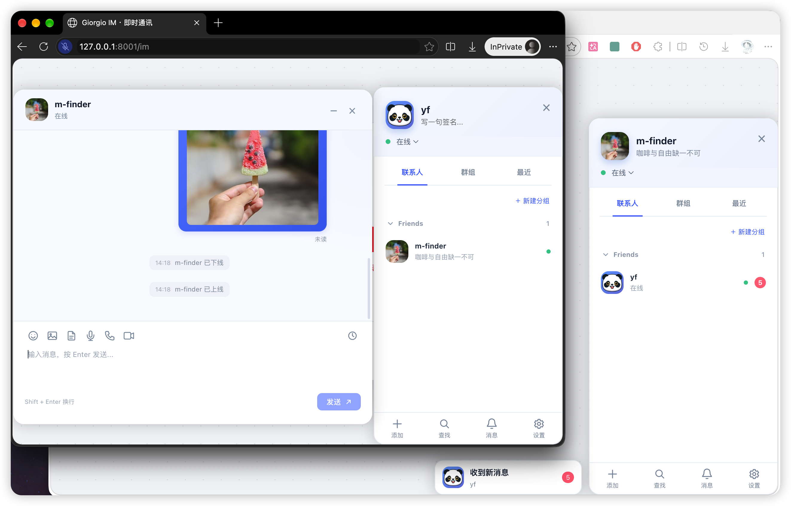

# Giorgio IM

[简体中文](README.md) | [English](README.en.md)

基于 Vue 3 和 TypeScript 的悬浮即时通讯组件，参考 LayIM 的交互与数据结构。通过 `createIM()` 引入即可使用，也可直接在 Vue 模板中挂载。

组件提供联系人、会话、消息展示和交互界面；可通过回调连接自己的服务，也可使用 `createConnectedIM()` 接入配套的 [Laravel + Giorgio Socket]( https://github.com/m-finder/giorgio-im-socket) 服务。

AI 请求与 RTC 通话需自行接入。

## 界面预览



## 功能概览

- **聊天界面**：独立、可拖动的联系人与聊天窗口，多会话侧栏、未读提醒、聊天记录、深浅色切换和手机端适配。
- **联系人**：可折叠的好友分组、拖拽移动好友、添加好友、分组选择、在线状态与消息盒子。
- **群聊**：建群、邀请、退群、群成员列表、群资料编辑、群主与管理员标识、踢人、禁言及解散。
- **消息工具**：128 个表情、图片、文件、语音录制与播放、语音和视频通话回调、自定义工具栏。
- **会话模式**：普通 IM、支持流式 Markdown 的 AI 对话、单窗口客服模式。
- **接入能力**：完整 TypeScript 类型、中文与英文、自定义语言包、可选的加密本地备份。

## 目录

- [快速开始](#快速开始)
- [Vue 组件方式](#vue-组件方式)
- [Laravel 与 Socket 接入](#laravel-与-socket-接入)
- [消息与数据](#消息与数据)
- [AI 与客服模式](#ai-与客服模式)
- [联系人与群管理](#联系人与群管理)
- [用户资料与附件](#用户资料与附件)
- [多语言](#多语言)
- [本地备份](#本地备份)
- [工具栏扩展](#工具栏扩展)
- [API 参考](#api-参考)
- [开发与验证](#开发与验证)
- [开源协议](#开源协议)

## 快速开始

### 运行 demo

在本仓库中执行：

```bash
npm install
npm run dev
```

打开终端输出的本地地址。demo 提供普通聊天、AI 对话和客服模式，默认中文，右上角可切换 English，也可使用 `?lang=en`。

中英文 demo 分别保存用户资料、好友、分组和聊天备份。切换模式会重置窗口位置、最大化状态、已打开会话和草稿，保留联系人与消息；普通刷新恢复备份。demo 的自动回复与通话提示均为本地模拟。

### 安装到项目

要求 Vue **3.3 或以上**。安装包发布在 [GitHub Packages](https://github.com/m-finder/giorgio-im/pkgs/npm/giorgio-im)，包名为 `@m-finder/giorgio-im`。

#### 从 GitHub Packages 安装

1. 在目标项目根目录的 `.npmrc` 中添加作用域配置，仅将 `@m-finder` 的包指向 GitHub：

   ```ini
   @m-finder:registry=https://npm.pkg.github.com
   ```

2. 使用 GitHub 账号登录该 registry：

   ```bash
   npm login --scope=@m-finder --auth-type=legacy --registry=https://npm.pkg.github.com
   ```

   Username 填你的 GitHub 用户名；Password 填具有 `read:packages` 权限的 **Personal access token (classic)**，不是 GitHub 登录密码。GitHub 的 npm registry 下载公开包也需要认证；不需要 npmjs 账号。凭据由 npm 保存在用户配置中，不要将真实 token 写入仓库的 `.npmrc`、源码或前端环境变量。

3. 安装组件：

   ```bash
   npm install @m-finder/giorgio-im@^0.1.1
   # 或
   pnpm add @m-finder/giorgio-im@^0.1.1
   ```

出现 401 / 403 时，先检查 token 是否过期、是否具有 `read:packages` 权限，以及登录 registry 是否为 `https://npm.pkg.github.com`。GitHub Actions 中安装时，应配置具有包读取权限的令牌；使用其他仓库的 `GITHUB_TOKEN` 时，还需为该仓库授予包的 Actions 访问权限。

#### 从本地安装包安装

也可以构建并打包本仓库，然后安装生成的文件：

```bash
# 在 Giorgio IM 仓库中，prepack 会自动执行构建
npm pack

# 在你的 Vue 项目中，替换为实际文件路径
npm install /path/to/giorgio-im/m-finder-giorgio-im-0.1.1.tgz
```

下文均使用包名 `@m-finder/giorgio-im` 导入。在支持 Vue SFC 和 Vite CSS 内联导入的源码项目中，也可直接引用本仓库的 `src/index.ts`。

### 创建实例

```ts
import { createIM, type ImInit } from '@m-finder/giorgio-im'

const init: ImInit = {
  user: { id: 'me', username: '我', sign: '今天也要保持联系', status: 'online' },
  friend: [{
    id: 'team', groupname: '同事',
    list: [{ id: 'alice', username: 'Alice', status: 'online' }],
  }],
  group: [{ id: 'room', groupname: '项目讨论', ownerId: 'me', members: 3 }],
}

const im = createIM({
  init,
  onSendMessage(payload) {
    console.log('在这里接入你的消息服务', payload)
  },
})

im.chat({ id: 'alice', type: 'friend', username: 'Alice' })
im.getMessage({ id: 'alice', type: 'friend', content: '你好！' })
```

`createIM()` 自动挂载到 `document.body` 并注入样式，无需单独导入 CSS，也无需安装 Tailwind。可传入 `target: HTMLElement` 指定挂载容器；窗口仍使用悬浮布局。

在浏览器环境中创建实例；Vue 项目可在 `onMounted` 中创建，在 `onBeforeUnmount` 中调用 `im.destroy()`。`destroy()` 卸载组件，应用自行清理 WebSocket、AI 请求和 RTC 连接。

## Laravel 与 Socket 接入

`createConnectedIM()` 封装配套 Laravel API 的认证、联系人与群管理、资料、附件、语音消息、历史记录和实时同步。

```ts
import { createConnectedIM } from '@m-finder/giorgio-im'

// token 来自 POST /api/im/login 或 /api/im/register。
const im = await createConnectedIM({
  apiUrl: '/api/im',
  token: () => currentToken,
  widget: { locale: 'zh-CN' },
  onConnectionChange(state) { console.log(state) },
  onError(error, operation, payload) {
    console.error(operation, error)
    // 发送失败时保留 payload，稍后 await im.sendMessage(payload) 重试。
  },
})
im.open()
// 页面卸载时清理组件、网络请求、连接和计时器。
// im.destroy()
```

| 配置 | 默认值 / 用途 |
| --- | --- |
| `token` | 必填，Sanctum token 或返回当前 token 的同步/异步函数 |
| `apiUrl` | `/api/im` |
| `socketUrl` | 使用 `/init` 返回的地址，可覆盖 |
| `pollInterval` | `5000` 毫秒，最小 `1000`；按游标补取事件 |
| `requestTimeout` | `15000` 毫秒 |
| `transport.requireTLS` | `true`，远程接口要求 HTTPS，WebSocket 要求 WSS |
| `transport.allowInsecureLocalhost` | `true`，HTTP 页面允许本机回环地址使用 HTTP/WS；设 `false` 连本机也要求 TLS |
| `widget` | 除 `init` 外的组件配置；服务端提供初始数据 |
| `onConnectionChange` | `connecting`、`online`、`reconnecting`、`offline`、`closed` |
| `onError` | 错误、操作名称、可选的失败发送数据 |

连接实例包含基础组件 API，以及 `sync()`、`reconnect()`、`sendMessage(payload)`、`deleteFriend(id)` 和只读的 `connectionState`。`deleteFriend()` 请求服务端删除关系；基础的 `removeFriend()` / `removeGroup()` 仅应用已收到的服务端结果。

生产环境为页面、API、附件和 WebSocket 配置可信证书，使用 HTTPS/WSS。适配器会在发送 token 前校验地址、拒绝接口重定向；HTTPS 页面始终拒绝降级到 HTTP/WS。`requireTLS: false` 仅用于明确允许明文的开发环境，不会关闭浏览器的证书校验。

```ts
const im = await createConnectedIM({
  token: accessToken,
  apiUrl: 'https://chat.example.com/api/im',
  socketUrl: 'wss://chat.example.com/socket',
  transport: { requireTLS: true, allowInsecureLocalhost: false },
})
```

自写注册、登录等请求可先调用包导出的 `assertImTransport(url, 'http', transport)`，通过后再发请求。TLS 加密由浏览器和服务器证书完成，无需在前端保存通信共享密钥；本地备份的 `encryptionKey` 不用于网络传输。服务端须同时启用相应策略，配置项见配套项目 `.env.example`。TLS 保护传输链路，服务端仍能读取消息内容。

WebSocket 通过短期票据认证，不把 token 放入 URL。推送触发 HTTP 按顺序补取持久化事件，断线期间继续轮询，恢复后自动重连。发送使用 `mid` 去重；重试同一条消息须保留原 `mid`。适配器中的 `widget.onSendMessage` 对普通消息在服务端保存成功后通知应用，AI 消息仍交给该回调处理。

管理、上传和历史回调由适配器接管；AI 与 `onCall` 仍需接自己的服务。服务端联系人及当前用户资料优先于可选的本地备份。重新登录后，打开会话加载最近 50 条历史；当前接口没有跨登录的服务端未读游标。

## Vue 组件方式

```vue
<script setup lang="ts">
import { ref } from 'vue'
import { ImWidget, type ImInit, type ImSendPayload, type ImWidgetApi } from '@m-finder/giorgio-im'

const widget = ref<ImWidgetApi | null>(null)
const init: ImInit = { user: { id: 'me', username: '我' }, friend: [], group: [] }

function handleSend(payload: ImSendPayload) {
  console.log('接入消息服务', payload)
}
</script>

<template>
  <button @click="widget?.chat({ id: 'alice', type: 'friend', username: 'Alice' })">联系 Alice</button>
  <ImWidget ref="widget" :init="init" locale="zh-CN" @send-message="handleSend" />
</template>
```

组件 ref 暴露与实例相同的 `ImWidgetApi`；`destroy()` 仅由 `createIM()` 返回。配置回调通常作为 prop 传入，例如 `:load-history="loadHistory"`、`:upload-avatar="uploadAvatar"`；通知回调使用事件，例如 `@username="saveUsername"`、`@group-renamed="onGroupRenamed"`。通话使用 `:on-call="onCall"`。

## 消息与数据

### 初始化数据

| 字段 | 类型与用途 |
| --- | --- |
| `init.user` | 必填，`ImUser`：`id`、`username`，可选 `avatar`、`sign`、`status: 'online' \| 'hide'` |
| `init.friend` | `ImFriendGroup[]`：每组包含 `id`、`groupname` 和 `list: ImContact[]` |
| `init.group` | `ImContact[]`：群使用 `groupname`，可包含 `members`、`ownerId`、`adminIds` 和 `muteAll` |
| `ImContact` | `id` 必填；好友使用 `username`，可含头像、签名和 `status: 'online' \| 'offline'`；AI 联系人设置 `type: 'ai'` |

ID 支持字符串或数字，包括 `0`。内部按字符串比较 ID，因此同类对象的 `1` 和 `'1'` 会被视为同一个对象。完整类型定义见 [src/types.ts](src/types.ts)。

### 发送与接收

发送文本或附件后，组件先显示自己的消息，再触发 `onSendMessage(payload)`。`ImSendPayload` 包含 `user`、`receiver`、`content`、`timestamp` 和可选的 `attachment`。投递确认、失败重试和消息服务协议由应用处理。

下面以 WebSocket 为例，地址、鉴权与服务端消息格式需替换为你的实现；发送前需确保连接已就绪，接收数据需在业务层校验：

```ts
import { createIM, type ImMessage } from '@m-finder/giorgio-im'

const socket = new WebSocket('wss://your-server.example/im')
const im = createIM({
  init, // 使用快速开始中的初始化数据
  onSendMessage(payload) {
    socket.send(JSON.stringify(payload))
  },
})

socket.addEventListener('message', event => {
  const message: ImMessage = JSON.parse(event.data)
  im.getMessage(message)
})
```

| `ImMessage` 字段 | 说明 |
| --- | --- |
| `id` / `type` | 必填，会话目标 ID 与 `'friend' \| 'group' \| 'ai'`；群消息的 `id` 是群 ID |
| `content` | 必填，消息文本；普通聊天按纯文本显示，AI 回复支持 Markdown |
| `mid` | 可选，消息 ID；普通消息用于去重，AI 流式回复用于关联同一条回复 |
| `fromid` / `mine` | 发送者 ID / 是否为自己的消息；`fromid` 等于当前用户 ID 时显示为自己发送 |
| `username` / `avatar` | 发送者昵称与头像；群消息需提供 `fromid` 才能识别角色标识 |
| `timestamp` | 可选，毫秒级时间戳，默认使用当前时间 |
| `attachment` | 可选，`{ kind: 'image' \| 'file' \| 'audio', url, name, duration? }`；时长单位为秒 |
| `finished` / `error` | AI 回复的完成标记与错误信息，见下节 |

### 历史消息与通知

`loadHistory(receiver)` 返回 `ImMessage[]` 或 Promise，每个会话首次打开时调用；失败后可在界面重试。已有本地备份历史的会话不会再次自动加载。聊天记录入口位于聊天工具栏右侧。

`notices: ImNotice[]` 可初始化消息盒子，之后调用 `im.getNotice()` 添加通知。`ImNotice` 包含 `id`、`type: 'system' | 'friend-request'`、`title`、`content`，可选 `timestamp`、`contact`、`read`、`resolved`；好友申请应附带 `contact`。

### 新消息提醒

未打开会话的未读消息会汇总到带头像、会话名称和未读数的“收到新消息”浮窗。点击后将待查看会话加入聊天侧栏，打开最近收到消息的会话；其他会话保留未读圆点，已在聊天侧栏中的会话不再显示浮窗。客服模式直接打开唯一客服窗口。

每次收到新的未读消息，浮窗会短暂左右震动；系统开启“减少动态效果”时不播放动画，恢复备份也不会重新震动。

```ts
import { createIM } from '@m-finder/giorgio-im'

const im = createIM({
  init,
  messageNotification: true, // 默认 true；false 关闭浮窗，保留未读计数
  messageSound: true,        // 默认 true；false 静音，也可传 '/sounds/message.mp3'
})
```

页面可见且聊天窗口打开时，已打开会话列表中的所有会话都不弹出新消息浮窗、不震动，也不播放提示音；未激活的会话仍累计未读并显示圆点。窗口最小化、关闭或页面隐藏后恢复提醒；返回页面只清除当前激活会话的未读。其他普通好友和群消息播放短提示音，连续消息会限频；AI 回复只在完成后计入提醒，不播放提示音。自己发送、重复消息、历史加载与备份恢复不会播放提示音。

浏览器可能在用户与页面交互前阻止声音播放，这不会影响收消息和浮窗。Vue 组件对应 `:message-notification` 和 `:message-sound`，文案支持内置与自定义语言包。

### 聊天状态、已读与正在输入

`createConnectedIM()` 自动连接配套接口的上下线、签名、已读和输入状态。上下线与签名更新在已打开的好友会话中显示为灰色居中提示，关闭或最小化时不累积；不计未读、不震动、不响铃。

```ts
const im = createIM({
  init,
  chatNotices: { presence: true, signature: true }, // 默认都显示
  onRead(payload) { /* 将 type、id、mids 发送给服务端 */ },
  onTyping(payload) { /* 将 type、id、typing 发送给服务端，不包含草稿 */ },
})

// 应用服务端状态，普通消息仍使用 getMessage。
im.setFriendStatus('alice', 'online')
im.getChatNotice({ id: 'alice', event: 'online', mid: 'event-1' })
im.getChatNotice({ id: 'alice', event: 'signature', sign: '新的签名', mid: 'event-2' })
im.setMessageRead({ id: 'alice', type: 'friend', mids: ['message-id'], readerId: 'alice' })
im.setTyping({ id: 'alice', type: 'friend', fromid: 'alice', typing: true, expiresAt: Date.now() + 6000 })
```

`onRead` 只在当前会话激活、窗口打开且页面可见时上报收到的消息；后台会话即使不触发新消息提醒，也不会自动标记已读。历史消息可带 `readBy: 用户ID[]`，私聊显示已读/未读，群聊显示已读人数。发送者不计入阅读者。

输入状态每 2 秒最多上报一次，停顿 3 秒、失焦、切换或关闭会话时停止；接收状态最多保留 6 秒，过期事件丢弃。AI 与系统提示不发送已读/输入回调。直接使用 Vue 组件时对应事件为 `@read` 和 `@typing`。

`chatNotices.signature=false` 控制本实例是否显示签名提示。配套后端的 `IM_SIGNATURE_NOTICES_ENABLED=false` 控制是否发送签名通知，资料本身仍正常更新。

## AI 与客服模式

### AI 对话

使用 `type: 'ai'`，通过相同的 `onSendMessage` 和 `getMessage()` 接入。模型请求和多轮上下文由应用按会话 ID 管理；浏览器应请求你的后端。

```ts
im.chat({ id: 'assistant', type: 'ai', username: 'AI 助手', maximized: true })

// 解析 SSE 或 WebSocket 事件后，传入截至当前的完整内容，不是增量片段。
im.getMessage({ id: 'assistant', type: 'ai', mid: 'reply-1', content: '你好', finished: false })
im.getMessage({ id: 'assistant', type: 'ai', mid: 'reply-1', content: '你好，**世界**！', finished: true })

// 请求失败时解除等待，保留已有部分内容。
// im.getMessage({ id: 'assistant', type: 'ai', mid: 'reply-1', content: '', error: '请求失败' })
```

- `finished` 默认 `true`，一次性回复可省略；同一条流式回复使用相同 `mid`，下一轮使用新 ID。省略 `mid` 时更新该会话当前等待的回复。
- 生成期间显示思考状态并禁用该会话再次发送。`chatTimeout` 默认 `60000` 毫秒，按首段或后续片段的等待间隔计时，每次更新都会重置。
- 最后一段需传最终完整内容及 `finished: true`。超时后应用应终止请求、忽略迟到事件，避免混入下一轮回复。
- AI 回复通过 `markdown-it` 渲染，禁用原始 HTML；自己发送的消息仍是纯文本。关闭窗口不会中止应用的网络请求。

### 客服模式

```ts
import { createIM } from '@m-finder/giorgio-im'

const im = createIM({
  init: { user: { id: 'visitor-1', username: '访客' } },
  customerService: { id: 'support', type: 'friend', username: '在线客服' },
  onSendMessage(payload) { console.log('发送给客服', payload) },
})

im.open()
im.close() // 回到最小浮窗，保留会话、消息和草稿
```

只显示指定客服的一个聊天窗口，隐藏联系人面板和多会话侧栏。关闭或缩小后显示右下角浮窗，收到消息显示未读数；手机端展开为全屏。客服可使用 `type: 'ai'`。该模式仅接受指定客服的 `chat()` 与 `getMessage()`；本地备份按用户和客服隔离，与普通 IM 独立。

## 联系人与群管理

### 好友与分组

底部“查找”筛选当前联系人、群组或最近列表；“添加好友”通过 `findContacts(query)` 查找新用户。好友申请同意前会选择分组，也可新建分组。已有好友可拖到空分组或折叠分组移动，离线头像自动置灰。

| 配置回调 | 成功返回值 |
| --- | --- |
| `findContacts(query)` | `ImContact[]` |
| `requestFriend(contact)` | 空值表示申请待对方处理；`true` 表示立即添加 |
| `acceptFriend(contact, groupId, notice)` | `true` 或空值 |
| `createFriendGroup(groupname)` | `ImFriendGroup`，包含服务端生成的 ID |
| `moveFriend(contact, groupId)` | `true` 或空值 |

以上支持同步返回值或 Promise。操作回调返回 `false` 或抛错表示失败；未配置管理回调时只在本地操作，新建分组使用本地 UUID。申请通过的服务端通知可调用 `im.addContacts(contact, groupId)`。

### 群资料与权限

群数据使用 `ownerId` 和 `adminIds` 指定角色；`loadGroupMembers(receiver)` 返回 `ImGroupMember[]` 或 Promise，成员可带 `muted: true`。标题栏的群成员按钮打开列表，点击其他成员可私聊。

| 操作 | 群主 | 管理员 | 普通成员 |
| --- | --- | --- | --- |
| 修改群名、群头像 | ✓ | ✓ | — |
| 禁言、移出普通成员 | ✓ | ✓ | — |
| 禁言、移出管理员 | ✓ | — | — |
| 设置、解除全员禁言 | ✓ | ✓ | — |
| 设置、取消管理员 | ✓ | — | — |
| 解散群聊 | ✓ | — | — |
| 邀请好友 | ✓ | ✓ | ✓ |
| 退出群聊 | 使用解散 | ✓ | ✓ |

群主与管理员不能对自己执行成员管理操作。全员禁言不限制群主、管理员发言，但管理员仍受群主设置的个人禁言限制。未提供角色数据时不显示管理操作；服务端始终负责校验权限。

| 配置回调 | 成功返回值 |
| --- | --- |
| `createGroup({ groupname, members })` | `ImContact`；`members` 不含当前用户，未返回 `ownerId` 时默认当前用户为群主 |
| `inviteGroupMembers(group, members)` / `leaveGroup(group)` | `true` 或空值 |
| `renameGroup(group, groupname)` | `true` 或空值；群名去除首尾空格后须为 1–40 个字符 |
| `uploadGroupAvatar(file, group)` | 头像 URL，要求同个人头像 |
| `setGroupAdmin(group, member, admin)` | `true` 或空值，`admin` 为布尔值 |
| `removeGroupMember(group, member)` / `dismissGroup(group)` | `true` 或空值 |
| `muteGroupMember(group, member, muted)` / `muteGroup(group, muted)` | `true` 或空值 |

这些回调支持 Promise。布尔操作返回 `false` 或抛错时保留原状态；上传回调应返回有效地址。成功后更新本地状态并触发对应通知回调，详见 [API 参考](#api-参考)。未配置时管理操作只在本地生效，群头像默认转为 Data URL。

### 应用服务端推送

```ts
im.setFriendStatus('alice', 'offline')
im.setGroupAdmin('room', 'alice', true)
im.setGroupMute('room', true)           // 全员禁言
im.setGroupMute('room', true, 'alice')  // 单独禁言，false 表示解除
im.removeFriend('alice')
im.removeGroup('room')                 // 被移出、退出或群已解散
```

这些实例方法用于应用服务端结果，不会再次调用保存接口或管理通知回调。`removeFriend()` 保留最近会话与聊天记录，清空未读，并禁止继续发送私信；迟到的普通消息不会恢复好友关系。`removeGroup()` 仍清理对应群会话。重新添加好友时调用 `addContacts()`。

### 删除好友与黑名单

好友列表向左滑动显示“删除好友”和“拉黑”，桌面端也可右键或按 Shift+F10 打开操作。删除和拉黑均保留最近会话与聊天记录；拉黑用户在私聊及共享群聊记录中置灰并显示“已被拉黑”。设置 → 黑名单可解除拉黑，解除后不会自动恢复好友关系。

```ts
const im = createIM({
  init, // 可传入 blocked: ImContact[] 和 recent: (ImContact & { type: ImChatType })[]
  deleteFriend: async contact => { await api.deleteFriend(contact.id) },
  blockFriend: async contact => { await api.blockFriend(contact.id) },
  unblockFriend: async contact => { await api.unblockFriend(contact.id) },
  onFriendRemoved: contact => console.log('deleted', contact.id),
  onFriendBlocked: contact => console.log('blocked', contact.id),
  onFriendUnblocked: contact => console.log('unblocked', contact.id),
})
await im.blockFriend('alice')
await im.unblockFriend('alice')
await im.deleteFriend('alice')
```

持久化回调返回 `false` 或抛错时保持本地状态；直接调用实例方法时，`false` 表示未执行成功，异常向调用方抛出。Vue 组件提供同名 props，以及 `@friend-removed`、`@friend-blocked`、`@friend-unblocked` 事件。无后端回调时只更新本地；开启备份后黑名单也会加密保存。安全规则必须由服务端校验。

`createConnectedIM()` 已接好删除、拉黑、解除及多端事件同步。配套 `giorgio-im-socket` 服务端会删除双向好友关系、拒绝未处理及后续好友申请，并禁止双方继续私信；历史只允许原会话参与者读取。`init.recent` 在无本地备份时恢复历史私聊入口。

## 用户资料与附件

### 昵称、签名和头像

点击面板顶部的昵称、签名可编辑，Enter 或失焦提交；昵称会去除首尾空格且不能为空，签名可清空。提交后分别触发 `onUsername(username)`、`onSign(sign)`，应用在回调中保存资料。这两个通知不会等待服务端保存或自动回滚。

点击头像选择 PNG、JPG、GIF、WebP 或 AVIF，最大 **2 MiB**。`uploadAvatar(file, user)` 返回 HTTP(S) 或相对图片 URL；成功后触发 `onAvatar(avatar)`，失败保留原头像。未配置时转为 Data URL，可随本地备份保存。群头像规则相同。

编辑后的资料同步自己的消息、成员列表和发送载荷，不修改传入的 `init.user`。宿主更新 `init.user.username`、`sign` 或 `avatar` 也会同步界面，不触发编辑通知。

### 图片、文件与语音

`uploadAttachment(file, receiver)` 返回可访问的 URL。图片和文件上传成功后触发带 `attachment` 的 `onSendMessage`；接收时将同样的附件结构传给 `getMessage()`。

语音录制依赖 `MediaRecorder`、麦克风权限与 HTTPS 或 localhost。点击麦克风录制，最长 **60 秒**；停止后可试听、取消或发送，只有发送时才上传。优先使用 `uploadVoice(file, receiver, duration)`，否则使用 `uploadAttachment`。上传失败保留录音供重试。

录音格式按浏览器能力选择 WebM、MP4 或 Ogg，服务端应按实际 MIME 类型保存。切换会话、关闭窗口、收到禁言或销毁组件会取消录音并释放麦克风。录音本身不备份。

### 语音与视频通话

`onCall({ type: 'voice' | 'video', user, receiver })` 将操作交给应用的 RTC / WebRTC 服务，支持 Promise。组件提供按钮与回调，不建立通话连接或提供通话界面。未配置 `onCall` 时，点击语音或视频通话会弹出提示，说明可接入第三方服务或自主开发。语音录制及通话按钮在 AI 会话中默认隐藏。

附件上传回调应返回持久 URL；demo 使用的临时 `blob:` URL 无法跨刷新恢复文件内容，本地备份只保存附件地址和元数据。

## 多语言

默认 `locale: 'zh-CN'`，内置 `en`，也接受 `en-US` 等英文地区代码。每个实例独立配置，`setLocale()` 可在运行时切换，不重置会话或草稿。

```ts
import { createIM, en, type ImLocales } from '@m-finder/giorgio-im'

const locales: ImLocales = {
  fr: {
    ...en,
    send: 'Envoyer',
    cancel: 'Annuler',
    emptyChat: 'Commencez à discuter avec {name}',
  },
}
const im = createIM({ init, locale: 'fr', locales })
im.setLocale('en')
im.setLocale('fr', { send: 'Envoyer le message' })
```

导出 `zhCN`、`en`、`ImLocaleKey`、`ImLocaleMessages`、`ImLocaleParams` 和 `ImLocales`。内置语言未覆盖的键使用默认文案；自定义语言缺少的键回退中文，使用 `...en` 可改为英文基底。运行时覆盖优先于 `locales`，重复调用按键合并。保留 `{name}`、`{count}`、`{group}` 等占位符，文案按纯文本显示。

Vue 组件可响应式传入 `:locale` 和 `:locales`。组件语言切换仅翻译界面，昵称、签名、分组、聊天、宿主通知、服务端错误及自定义工具栏文案由应用提供；demo 通过独立中英文账号数据展示对应资料。时间按当前地区格式显示，无效地区代码回退 `zh-CN`。

## 本地备份

```ts
import { createIM } from '@m-finder/giorgio-im'

const im = createIM({
  init,
  enableLocalStorage: true,       // 默认 false
  encryptionKey: 'giorgio-im',    // 默认值，正式使用请自行配置
  onStorageError(error) { console.error(error.message) },
})
```

备份包括用户资料、联系人与群组、会话与消息、未读数、通知、输入草稿和窗口开关状态。变更后自动保存，刷新时恢复；本地备份资料优先于初始化数据。恢复不触发编辑或发送回调，不会重新发送消息。未完成的 AI 回复保留内容并标记中断，不会重启请求。

- 按 `init.user.id` 隔离；普通模式的键为 `giorgio-im-backup:${encodeURIComponent(String(init.user.id))}`，客服模式额外按客服隔离。切换账号需销毁旧实例并重新创建。
- 使用 AES-256-GCM，PBKDF2-SHA256 派生密钥（100000 次迭代、随机 16 字节盐），每次保存使用随机 12 字节 IV。仅保存版本、盐、IV 和密文，不保存密钥。
- 运行时关闭开关停止读写，保留旧备份；再次开启保存当前状态。密钥错误、密文损坏、空间不足或存储不可用通过 `onStorageError` 报告，聊天仍可使用；读取失败保留原备份。
- 修改密钥不会迁移旧备份。恢复旧数据需使用原密钥，重新开始可由应用移除对应备份后重建实例。默认密钥是公开值；前端加密不能防止同源恶意脚本或持有密钥者访问数据，也不替代服务端持久化。

主题和发送快捷键独立存储在 `giorgio-im-settings:${init.user.id}`，不受聊天备份开关控制。

## 工具栏扩展

内置 ID：`emoji`、`image`、`file`、`voice`、`voice-call`、`video-call`、`history`。相同 ID 覆盖原按钮，新 ID 添加按钮。

```ts
import { createIM, type ImToolbarItem } from '@m-finder/giorgio-im'

const toolbar: ImToolbarItem[] = [
  { id: 'file', visible: false },
  { id: 'image', label: '相册', title: '选择照片' },
  {
    id: 'quick-reply', label: '快捷回复',
    icon: 'm13 3-9 11h7l-1 7 10-12h-7l1-6Z',
    visible: ({ receiver }) => receiver.type !== 'ai',
    onClick({ insertText }) { insertText('收到，稍后回复你。') },
  },
  { id: 'history', onClick({ runDefault }) { runDefault() } },
]
const im = createIM({ init, toolbar })
im.setToolbar([]) // 清除扩展与覆盖，恢复内置默认配置
```

| 字段 | 说明 |
| --- | --- |
| `id` | 必填，唯一按钮 ID |
| `label` / `title` | 无障碍名称 / 悬停提示 |
| `icon` / `text` | 24×24 SVG path 的 `d` / 文字按钮；`text` 优先，不接受原始 HTML |
| `visible` / `disabled` | 布尔值或 `(state: ImToolbarState) => boolean` |
| `align` / `order` | `left` 或 `right`，每侧升序；新按钮默认左侧、100，内置顺序为 10–60 和 1000 |
| `onClick(context)` | 替换点击行为，支持 Promise；调用 `runDefault()` 保留原功能 |

`context` 包含 `id`、`user`、`receiver`、`draft`、`restriction`、`setDraft()`、`insertText()`（追加）和 `runDefault()`。新按钮没有默认动作。异步执行时禁用同一按钮；切换会话、替换配置或销毁后，旧助手失效。图片/文件选择器需在同步点击阶段调用 `runDefault()`。

禁言及 AI 等待期间，除聊天记录外的按钮和助手受统一限制，`disabled: false` 不能绕过。`setToolbar(items)` 替换整份扩展配置；Vue `toolbar` prop 更新会覆盖运行时配置。配置和回调不写入备份。

## API 参考

完整签名见 [src/types.ts](src/types.ts)，包导出见 [src/index.ts](src/index.ts)。

### 基础配置

| 配置 | 默认值 / 用途 |
| --- | --- |
| `init` | 必填，用户与联系人初始化数据 |
| `target` | `document.body`；仅 `createIM()` 使用 |
| `locale` / `locales` | `'zh-CN'` / 自定义语言包 |
| `customerService` | 未启用；指定唯一客服联系人 |
| `enableLocalStorage` / `encryptionKey` | `false` / `'giorgio-im'` |
| `notices` | `[]`，消息盒子初始通知 |
| `messageNotification` | `true`，未读消息浮窗；关闭后仍累计未读 |
| `messageSound` | `true`，内置合成提示音；`false` 静音，字符串指定自定义音频 URL（如 `'/sounds/message.mp3'`）；AI 回复静音 |
| `chatNotices` | `{ presence?: boolean, signature?: boolean }`，默认都开启；仅影响静默状态提示的显示 |
| `chatTimeout` | `60000`，AI 回复片段的等待超时，单位毫秒 |
| `toolbar` | 内置工具栏，按 ID 扩展或覆盖 |

加载、上传及管理配置回调见前文对应章节。

### 实例方法

| 方法 | 用途 |
| --- | --- |
| `open()` / `close()` | 展开联系人面板 / 收起联系人与聊天窗口；客服模式展开或最小化唯一会话 |
| `resetWindows()` | 关闭窗口，重置位置、最大化状态、已打开会话、查找和草稿，保留资料、联系人与消息 |
| `chat(contact)` | 打开会话；必填 `id`、`type`，群使用 `groupname`，好友与 AI 使用 `username` |
| `getMessage(message)` | 接收 `ImMessage`，也用于 AI 流式更新 |
| `addContacts(contact, groupId?)` | 添加好友、AI 或群；好友可指定分组，不用于更新已有联系人资料 |
| `addFriendGroup(group)` | 添加或更新分组，包含 `id`、`groupname` 和 `list` |
| `setContacts({ friend, group, blocked?, recent? })` | 应用完整服务端快照，保留已删除好友的聊天记录 |
| `setUser(user)` | 更新当前用户资料，不触发保存回调；不能修改 ID |
| `updateContact(contact, groupId?)` | 新增或更新联系人及其已打开会话中的资料 |
| `setGroupMembers(id, members)` | 应用群成员列表与成员禁言状态 |
| `moveFriend(id, groupId)` | 移动到已有分组，成功返回 `true`，不存在的好友或分组返回 `false` |
| `removeFriend(id)` / `removeGroup(id)` | 应用移除通知；好友保留历史，群会话清理 |
| `deleteFriend(id)` / `blockFriend(id)` / `unblockFriend(id)` | 先调用持久化回调，再更新界面，返回 `Promise<boolean>` |
| `setFriendBlocked(contact, blocked)` / `setBlockedUsers(contacts)` | 应用服务端拉黑状态或完整黑名单，不触发保存回调 |
| `getBlockedUsers()` | 返回当前黑名单的副本 |
| `setFriendStatus(id, status)` | 设置 `'online'` 或 `'offline'`，离线头像置灰 |
| `setChatStatus(text, receiver?)` | 设置指定或当前会话标题下的状态文字 |
| `getChatNotice(notice)` | 为打开的好友会话追加上下线或签名提示，可用 `mid` 去重 |
| `setMessageRead(receipt)` | 应用已读回执，包含 `id,type,mids,readerId` |
| `setTyping(state)` | 应用含 `id,type,fromid,typing,expiresAt?` 的临时输入状态 |
| `setGroupMute(id, muted, memberId?)` | 设置全员禁言；传 `memberId` 时只设置该成员 |
| `setGroupAdmin(id, memberId, admin)` | 应用管理员任免结果 |
| `getNotice(notice)` | 添加通知；同 ID 已存在时更新其内容与处理状态 |
| `setToolbar(items)` | 替换工具栏扩展配置，`[]` 恢复默认 |
| `setLocale(locale, messages?)` | 切换语言，可同时注册或覆盖文案 |
| `destroy()` | 仅 `createIM()` 返回，卸载实例 |

### 通知回调与 Vue 事件

`onRead(payload)` / Vue `@read` 上报可见会话已查看的消息；`onTyping(payload)` / Vue `@typing` 上报输入开始或停止。`createConnectedIM()` 会自动处理这些接口请求，并保留应用回调。

这些回调用于通知应用发生的变化，与前文用于保存操作的管理回调区分。`onSendMessage` 在本地发送时触发；资料编辑与成功的管理操作触发相应通知。实例方法应用服务端结果时不重复触发管理通知。

| `createIM` 回调 | Vue 事件 | 参数 |
| --- | --- | --- |
| `onSendMessage` | `send-message` | `payload: ImSendPayload` |
| `onRead` | `read` | `payload: ImReadPayload` |
| `onTyping` | `typing` | `payload: ImTypingPayload` |
| `onOnline` | `online` | `status: 'online' \| 'hide'` |
| `onUsername` / `onSign` / `onAvatar` | `username` / `sign` / `avatar` | 对应字符串值 |
| `onStorageError` | `storage-error` | `error: Error` |
| `onChatChange` | `chat-change` | `receiver` |
| `onFriendAdded` | `friend-added` | `contact, groupId?` |
| `onNoticeAction` | `notice-action` | `notice, action: 'accept' \| 'reject' \| 'read', groupId?` |
| `onFriendGroupAdded` | `friend-group-added` | `group` |
| `onFriendMoved` | `friend-moved` | `contact, groupId` |
| `onGroupCreated` / `onGroupLeft` | `group-created` / `group-left` | `group` |
| `onGroupMembersInvited` | `group-members-invited` | `group, members` |
| `onGroupMemberRemoved` | `group-member-removed` | `group, member` |
| `onGroupDismissed` | `group-dismissed` | `group` |
| `onGroupMemberMuted` | `group-member-muted` | `group, member, muted` |
| `onGroupMuted` | `group-muted` | `group, muted` |
| `onGroupRenamed` / `onGroupAvatarChanged` | `group-renamed` / `group-avatar-changed` | 更新后的 `group` |
| `onGroupAdminChanged` | `group-admin-changed` | `group, member, admin` |

## 开发与验证

```bash
npm run dev        # 本地 demo
npm run typecheck  # TypeScript 检查
npm test           # Vitest 测试
npm run build      # 类型检查、ES / UMD 构建及声明文件
```

源码入口为 `src/index.ts`，组件为 `src/ImWidget.vue`，demo 位于 `demo/`，测试位于 `tests/`。构建产物在 `dist/`，包含 `giorgio-im.js`、`giorgio-im.umd.cjs` 和 TypeScript 声明文件。

## 开源协议

本项目采用 [MIT License](LICENSE)。第三方依赖遵循各自的许可证。
